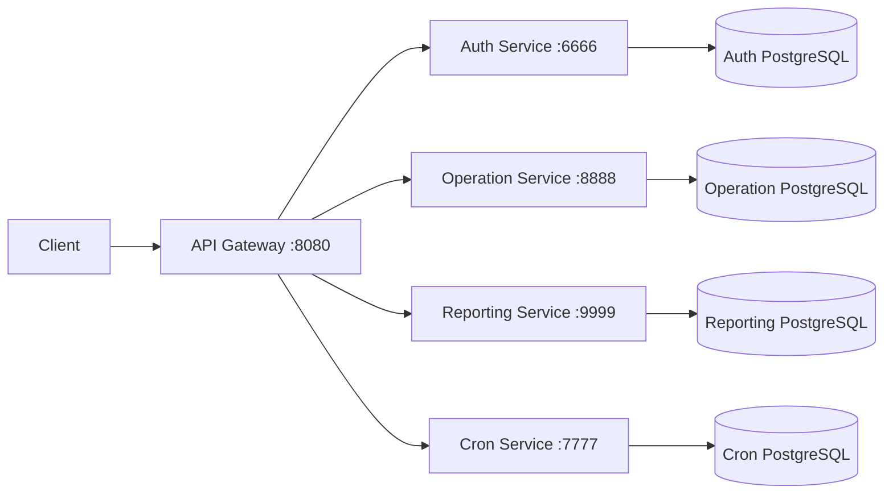

# iShop Electronics Platform

## Project Overview

iShop is a Spring Boot microservices system for selling and managing electronics products. It provides authentication, product operations, orders, reporting, and scheduled jobs. The API Gateway is the public HTTP entry point; services retain their own business logic and JWT enforcement.

| Service | Responsibility |
|---|---|
| Gateway | Routing, CORS, and health endpoint |
| Auth | Registration, login, refresh tokens, users and roles |
| Operation | Products, customers, orders, and inventory |
| Reporting | Reports and stored report snapshots |
| Cron | Scheduled reporting/archive jobs and status |

## Architecture



## Technology Stack

- Java 21 and Spring Boot 3.3.5
- Spring Cloud Gateway 2023.0.3
- Spring MVC, Spring Data JPA, Spring Security, Bean Validation
- PostgreSQL 16, JWT (JJWT 0.12.6), Lombok
- Gradle and Docker Compose

## Project Structure

```text
.
├── gateway-service/
├── auth-service/
├── operation-service/
├── reporting-service/
├── cron-service/
├── docker-compose.yml
├── postman/
└── gradlew.bat
```

## Getting Started

Prerequisites: Java 21, Docker Desktop, and PowerShell.

```powershell
docker compose up -d --build
.\gradlew.bat -p auth-service bootRun
.\gradlew.bat -p operation-service bootRun
.\gradlew.bat -p reporting-service bootRun
.\gradlew.bat -p cron-service bootRun
```

Check the gateway with `GET http://localhost:8080/actuator/health`. The Compose gateway defaults to locally running services through `host.docker.internal`. Override `AUTH_SERVICE_URL`, `OPERATION_SERVICE_URL`, `REPORTING_SERVICE_URL`, and `CRON_SERVICE_URL` for container service names.

Open the aggregated Swagger UI at `http://localhost:8080/swagger-ui.html`. Its service selector loads the OpenAPI documents for Auth, Operation, Reporting, and Cron through the gateway. The documentation endpoints are public; the business endpoints shown in them still require the existing JWT authentication.

## API Access

Use `http://localhost:8080` as the primary API base URL.

| Gateway prefix | Downstream paths |
|---|---|
| `/api/auth/**` | `/auth/**` and `/users/**` |
| `/api/operations/**` | `/products/**`, `/customers/**`, `/orders/**` |
| `/api/reports/**` | `/reports/**` |
| `/api/jobs/**` | `/jobs/status` |

Authentication endpoints are `POST /api/auth/register`, `POST /api/auth/login`, and `POST /api/auth/refresh`. Send the returned access token as `Authorization: Bearer <token>` for protected requests. JWT validation remains in each downstream service.

## Database Configuration

| Service | Database | Host port |
|---|---|---:|
| Auth | `auth_service_db` | 5555 |
| Operation | `operation_service_db` | 5433 |
| Reporting | `reporting_service_db` | 5434 |
| Cron | `cron_service_db` | 5435 |

The gateway has no database. PostgreSQL credentials and volumes are defined in `docker-compose.yml`.

## Development

```powershell
.\gradlew.bat -p gateway-service build
.\gradlew.bat -p auth-service test
```

The gateway uses environment-configurable downstream URLs and exposes only `health` and `info` actuator endpoints.

## Notes

- The gateway does not issue JWTs; downstream services preserve existing authentication and authorization.
- In production, expose only the gateway and place downstream services on a private network.
- Replace the development admin credentials in `auth-service/src/main/resources/application.yml` for non-development use.
